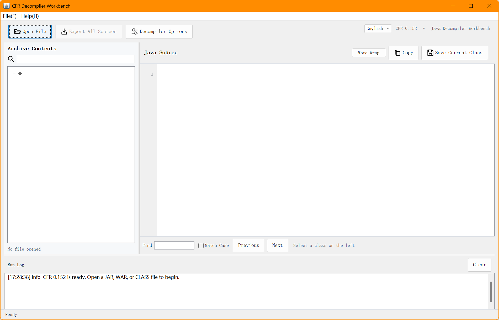

# CFR Graphical Decompilation Workbench

> **CFR (Cfr Reader) Lightweight GUI Frontend**, based on **org.benf:cfr:0.152**. The original `cfr-0.152.jar` is not modified; CFR is embedded in `cfr-studio.jar`, so no additional installation is needed to use the GUI.

## Project Introduction

CFR Graphical Decompilation Workbench is a tool to help developers **browse, decompile, and export Java class source code**. It encapsulates the core functionality of CFR 0.152, providing a graphical interface so you don't need to operate from the command line:

- Open JAR, WAR, or CLASS files  
- Browse classes in the archive, filter by package/ class name  
- Decompile selected classes, view Java source with line numbers and syntax highlighting  
- Search, copy, and save the current class  
- Export all source code to a local directory  
- **Now supports switching Chinese ↔ English interface language at any time**  

## Key Features

| Feature | Description |
|---------|-------------|
| **Language Switching** | Language selector in the top-right corner, switch between **Chinese** and **English** at any time, language preference saved for next launch |
| **File Browsing & Filtering** | Tree on the left displays archive files; type keywords to filter by class name or package |
| **Decompilation** | Click any class on the left; the right panel immediately shows decompiled Java source with line numbers and syntax highlighting |
| **Search & Marking** | Search within source, case-sensitive matching, highlight matches, navigate between previous/next matches |
| **Export Source Code** | Select an empty directory, click "Export All Sources". All decompiled classes are exported as UTF-8 Java files, preserving the package structure |
| **Decompiler Options** | Check/untick options such as preserving CFR diagnostic comments, restoring Lambda expressions, merging inner classes, renaming illegal identifiers, anti-obfuscation optimizations, lenient exception handling, bytecode locations, etc. |
| **Log Panel** | Real-time display of background processing info, errors, and diagnostics |
| **Shortcuts** | `Ctrl+O` to open a file, `Ctrl+S` to save the current class |

## Getting Started

### From Maven Build

```bash
# Clone / enter the project directory
git clone <your-repo>
cd cfr-studio

# Build with Maven (Java 21)
mvn clean package -DskipTests

# Generated jar is in target/
ls target/
# cfr-studio-1.0.0.jar
```

### Run Pre-packaged JAR Directly

```bash
java -jar target/cfr-studio-1.0.0.jar
# Or double-click the jar
```

### Pass a File to Open

```bash
java -jar target/cfr-studio-1.0.0.jar "D:\path\to\application.jar"
```

## Usage Guide

1. **Open File**  
   - Click the "Open File" button on the toolbar (or shortcut `Ctrl+O`), select `.jar` / `.war` / `.class` files.  
   - Or drag the file into the main window.

2. **Browse Classes**  
   - The tree on the left lists all classes in the archive.  
   - Type keywords in the search box above to filter by class name or package name in real time.

3. **Decompile**  
   - Click any class in the tree; the right panel immediately displays the decompiled Java source code.  
   - Use the search box on the toolbar to find, highlight matches in the source code.

4. **Save / Export**  
   - **Save Current Class**: Click "Save Current Class" button, save as `.java`.  
   - **Export All Source Code**: Select an **empty directory**, click "Export All Sources". The tool will export all decompiled classes as UTF-8 Java files, preserving the original package structure.

5. **Language Switching**  
   - In the dropdown menu on the far right of the toolbar, select **Chinese** or **English**.  
   - The language choice is saved during the session and automatically restored on the next startup.

6. **Decompiler Options**  
   - Open the "Decompiler Options" menu to open the configuration dialog, check/uncheck relevant options (such as preserving CFR diagnostic comments, restoring Lambda expressions, etc.).  
   - After modification, the next class selected will automatically apply the new parameters.

## Screenshot Example



> (Screenshot showing the Chinese interface; the language selector in the top-right corner is the language switching entry.)

## License

This project is based on the **CFR 0.152** open source license, under the **leibnitz27/cfr** project license. More details at <https://github.com/leibnitz27/cfr>.

## Acknowledgments

- **CFR** – the core decompilation engine, thank you to the author for the contribution.  
- **Maven** – the project build tool.  
- **All students using and contributing code** – making this tool better and better.

---

**Enjoy decompilation, and have fun!**
